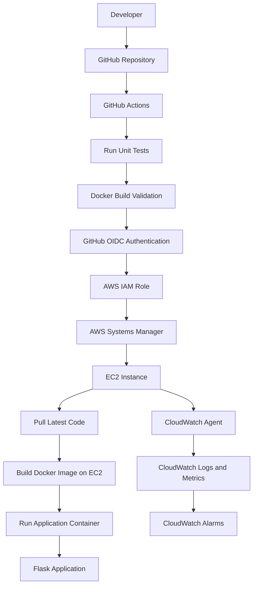

# CloudDeploy AWS

### Automated DevOps Deployment Platform Using Docker, GitHub Actions and AWS

## Overview

CloudDeploy AWS is a DevOps learning project that automates the testing, containerization, deployment, and monitoring of a Python Flask application using GitHub Actions and AWS.

Whenever code is pushed to the `main` branch, GitHub Actions runs unit tests, validates the Docker image build, and deploys the application to an AWS EC2 instance.

The project uses AWS IAM with GitHub OIDC authentication and AWS Systems Manager for secure deployment. Amazon CloudWatch is used for infrastructure monitoring and application logging.

## Architecture



## Key Features

- Automated CI/CD pipeline using GitHub Actions.
- Automated unit testing.
- Docker image build validation.
- Automated deployment to AWS EC2.
- GitHub OIDC authentication without long-lived AWS access keys.
- AWS Systems Manager for remote deployment commands.
- Docker health checks.
- Container resource limits and security hardening.
- CloudWatch monitoring for CPU, memory, and disk usage.
- Centralized application logs in CloudWatch.

## Technology Stack

| Category | Technology |
|---|---|
| Programming Language | Python 3.12 |
| Framework | Flask |
| Web Server | Gunicorn |
| Containerization | Docker |
| CI/CD | GitHub Actions |
| Cloud Platform | AWS |
| Compute | Amazon EC2 |
| Identity and Access | AWS IAM |
| Authentication | GitHub OIDC |
| Remote Management | AWS Systems Manager |
| Monitoring and Logging | Amazon CloudWatch |
| Version Control | Git and GitHub |
| Operating System | Ubuntu Server |

## AWS Infrastructure

### Amazon EC2
Hosts the Flask application inside a Docker container.

### AWS IAM
Provides permissions to GitHub Actions and the EC2 instance through IAM roles.

### GitHub OIDC
Allows GitHub Actions to authenticate with AWS without storing permanent AWS access keys.

### AWS Systems Manager
Executes deployment commands remotely on the EC2 instance.

### Amazon CloudWatch
Collects infrastructure metrics and application logs.

The project monitors:
- CPU utilization
- Memory utilization
- Disk utilization
- Application container logs

CloudWatch alarms are configured to monitor high resource utilization.

## CI/CD Pipeline

The GitHub Actions workflow contains three main jobs.

### 1. Test Application
- Checks out the repository.
- Sets up Python 3.12.
- Installs application dependencies.
- Runs unit tests.

### 2. Docker Build
- Builds the Docker image on the GitHub Actions runner.
- Validates the Docker build process.

### 3. Deploy Application
After successful validation on pushes to `main`:
- Authenticates with AWS using GitHub OIDC.
- Sends deployment commands through AWS Systems Manager.
- Retrieves the latest application code on EC2.
- Builds the Docker image on the EC2 instance.
- Replaces the existing application container.
- Verifies the application health endpoint.

## Docker Security

The application container uses the following security practices:

- Runs as a non-root user.
- Uses a read-only root filesystem.
- Drops unnecessary Linux capabilities.
- Enables `no-new-privileges`.
- Applies memory and CPU limits.
- Applies a process limit.
- Uses a Docker health check.
- Configures automatic container restart.

## Application Endpoints

| Endpoint | Description |
|---|---|
| `/` | Application homepage |
| `/health` | Application health check |

Example health check response:

```json
{
  "application": "CloudDeploy AWS",
  "status": "healthy"
}
```

## Project Structure

```text
clouddeploy-aws/
├── .github/
│   └── workflows/
│       └── ci.yml
├── app/
│   └── app.py
├── tests/
│   └── test_app.py
├── docs/
│   └── architecture.md
├── Dockerfile
├── requirements.txt
└── README.md
```

## Run Locally

### Prerequisites
- Python 3.12
- Git
- Docker (optional)

### Clone the Repository

```bash
git clone https://github.com/Saheba-Bagwan/clouddeploy-aws.git
cd clouddeploy-aws
```

### Create a Virtual Environment

```bash
python3 -m venv .venv
source .venv/bin/activate
```

### Install Dependencies

```bash
pip install -r requirements.txt
```

### Run the Application

```bash
python -m app.app
```

Open the application:

`http://127.0.0.1:5000`

Health check:

`http://127.0.0.1:5000/health`

## Run with Docker

### Build the Image

```bash
docker build -t clouddeploy-aws:latest .
```

### Run the Container

```bash
docker run -d \
  --name clouddeploy-container \
  -p 5000:5000 \
  clouddeploy-aws:latest
```

### Verify the Container

```bash
docker ps
```

```bash
curl http://localhost:5000/health
```

### View Container Logs

```bash
docker logs clouddeploy-container
```

### Stop and Remove the Container

```bash
docker stop clouddeploy-container
docker rm clouddeploy-container
```

## Testing

Unit tests are implemented using Python's built-in `unittest` framework.

Run the tests:

```bash
python -m unittest discover -s tests -v
```

The test suite verifies:
- Homepage availability.
- Health endpoint availability.
- Expected health response data.

## Learning Outcomes

Through this project, I gained practical experience with:

- Linux-based application deployment.
- Docker image creation and container management.
- CI/CD pipeline configuration using GitHub Actions.
- Automated application testing.
- AWS EC2 deployment.
- IAM roles and GitHub OIDC authentication.
- AWS Systems Manager.
- CloudWatch metrics, logs, and alarms.
- Basic Docker container security practices.

## Future Improvements

Potential future enhancements:

- Infrastructure provisioning using Terraform.
- Docker image storage using Amazon ECR.
- HTTPS configuration.
- Automated deployment rollback.
- Deployment notifications.

These are planned improvements and are not part of the current implementation.

## Project Status

**Core implementation completed.**

The application is containerized, tested through GitHub Actions, deployed to AWS EC2, and monitored using Amazon CloudWatch.

This project was developed as a hands-on learning project to understand the fundamentals of DevOps and AWS deployment automation.

## Author

**Saheba Bagwan**

GitHub: [Saheba-Bagwan](https://github.com/Saheba-Bagwan)